<div align="center">

  <!-- ==================== REAL GITHUB AVATAR ==================== -->
  <a href="https://github.com/MoeenUddin01">
    
  </a>

  <br/><br/>

  <!-- ==================== FUTURISTIC HERO BANNER ==================== -->
  

  <br/><br/>

  <!-- ==================== QUICK STATUS PILLS ==================== -->
  <p align="center">
    <a href="https://github.com/MoeenUddin01">
      
    </a>
    <a href="https://github.com/MoeenUddin01?tab=repositories">
      
    </a>
    <a href="mailto:moeenuddin051@gmail.com">
      
    </a>
  </p>

</div>


<!-- ==================== EXECUTIVE INTRODUCTION ==================== -->
## 🛰️ // SYSTEM OVERVIEW

```yaml
Engineer: Moeen Uddin
Role: Senior AI Systems & Autonomous Agents Engineer
Core Pillars: Multi-Agent Workflows | Spec-Driven RAG | Closed-Loop Robotics
Architecture Paradigm: Model Context Protocol (MCP) & Deterministic Verification
Status: Exploring emergent agent coordination & resilient context engineering
```

I design and deploy production-grade **Autonomous Multi-Agent Systems**, **Spec-Driven RAG Pipelines**, and **Physics-Integrated Predictive AI**. My engineering philosophy bridges deterministic software craft with adaptive neural architectures — ensuring reasoning engines, agentic tool dispatch, and edge models operate with sub-millisecond precision, zero hallucination drift, and rigorous observability.

<br/>


<!-- ==================== GLASS AQUARIUM & VIRTUAL KOI COMPANION ==================== -->
## 🌊 // CYBER AQUARIUM & VIRTUAL KOI COMPANION

<p align="left">
  <i>A cybernetic aquatic habitat blending handcrafted vector art with autonomous contribution-driven evolution. The aquarium on the left features continuous swimming animation, ambient lighting, and aquatic flora, while the companion on the right is rendered directly from my daily GitHub activity using <b>Git Koi</b>.</i>
</p>

<table border="0" width="100%" cellspacing="0" cellpadding="8">
  <tr>
    <td width="58%" align="center" valign="middle">
      <p align="center">
        <b>NEON GLASS AQUARIUM</b><br/>
        <sub>3 Animated Swimming Koi • Bioluminescent Flora • Rising Bubble Stream</sub>
      </p>
      
    </td>
    <td width="4%"></td>
    <td width="38%" align="center" valign="middle">
      <p align="center">
        <b>DAILY GIT KOI COMPANION</b><br/>
        <sub>Autonomous Evolution Powered by GitHub Activity</sub>
      </p>
      <p align="center">
        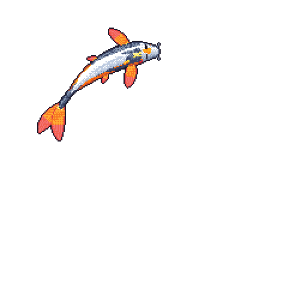
      </p>
      <p align="left">
        <b>Coat & Patterns:</b> Derived from repository language breakdown<br/>
        <b>Growth & Marks:</b> Shaped by verified contribution streaks<br/>
        <b>Swimming Motion:</b> Driven by yesterday's commit momentum
      </p>
    </td>
  </tr>
</table>

<br/>


<!-- ==================== NEON TECHNOLOGY BADGES ==================== -->
## ⚡ // TECHNICAL ARSENAL & TOOLCHAINS

<p align="left">
  <i>Production-validated technologies identified across my 39 active public repositories.</i>
</p>

<table border="0" width="100%" cellspacing="0" cellpadding="6">
  <tr>
    <td width="25%" align="center"></td>
    <td width="25%" align="center"></td>
    <td width="25%" align="center"></td>
    <td width="25%" align="center"></td>
  </tr>
  <tr>
    <td width="25%" align="center"></td>
    <td width="25%" align="center"></td>
    <td width="25%" align="center"></td>
    <td width="25%" align="center"></td>
  </tr>
  <tr>
    <td width="25%" align="center">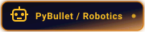</td>
    <td width="25%" align="center"></td>
    <td width="25%" align="center"></td>
    <td width="25%" align="center"></td>
  </tr>
</table>

<br/>


<!-- ==================== FEATURED PROJECTS ==================== -->
## 🚀 // FEATURED NEURAL SYSTEMS & CODEBASES

<p align="left">
  <i>Highlighting flagship architectures spanning autonomous multi-agent coordination, deterministic RAG retrieval, and predictive robotic physics.</i>
</p>

<table border="0" width="100%" cellspacing="0" cellpadding="6">
  <tr>
    <td width="50%" align="center">
      <a href="https://github.com/MoeenUddin01/AgentMart">
        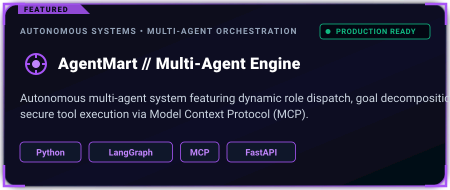
      </a>
    </td>
    <td width="50%" align="center">
      <a href="https://github.com/MoeenUddin01/SpecRAG">
        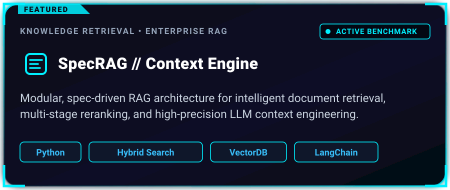
      </a>
    </td>
  </tr>
  <tr>
    <td width="50%" align="center">
      <a href="https://github.com/MoeenUddin01/AegisArm">
        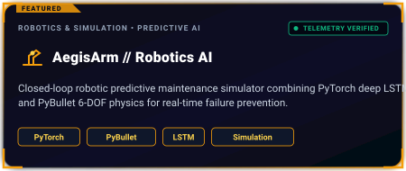
      </a>
    </td>
    <td width="50%" align="center">
      <a href="https://github.com/MoeenUddin01?tab=repositories">
        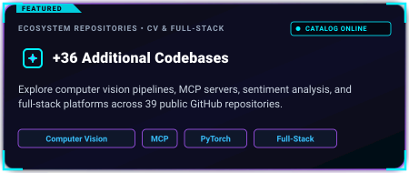
      </a>
    </td>
  </tr>
</table>

<br/>


<!-- ==================== GITHUB TELEMETRY & LIVE STATS ==================== -->
## 📊 // GITHUB TELEMETRY & ACTIVITY METRICS

<p align="left">
  <i>Telemetry HUD reflects a verified metric snapshot from GitHub API (calendar-year contributions, public repositories, and repo distribution). The streak telemetry card updates dynamically.</i>
</p>

<div align="center">
  <!-- Custom Neon HUD Telemetry Card -->
  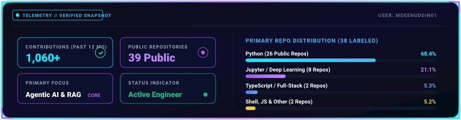
  
  <br/><br/>

  <!-- Live GitHub Streak Stats (Demolab API) -->
  
</div>

<br/>


<!-- ==================== GAMIFIED CONTRIBUTION SNAKE ==================== -->
## 👾 // NEURAL CONTRIBUTION SNAKE

<div align="center">
  <p align="center">
    <i>An autonomous cyber-snake traversing my real GitHub contribution matrix. Generated nightly via GitHub Actions.</i>
  </p>

  <picture>
    <source media="(prefers-color-scheme: dark)" srcset="https://raw.githubusercontent.com/MoeenUddin01/MoeenUddin01/output/github-snake-dark.svg">
    <source media="(prefers-color-scheme: light)" srcset="https://raw.githubusercontent.com/MoeenUddin01/MoeenUddin01/output/github-snake.svg">
    
  </picture>
</div>

<br/>


<!-- ==================== CONNECT & COMMS ==================== -->
## 📡 // SECURE COMMUNICATIONS

<div align="center">
  <p>
    Interested in collaborating on Autonomous Agents, High-Precision RAG, or Robotic Predictive Maintenance?
  </p>

  <p>
    <a href="https://github.com/MoeenUddin01">
      
    </a>
    &nbsp;&nbsp;
    <a href="mailto:moeenuddin051@gmail.com">
      
    </a>
    &nbsp;&nbsp;
    <a href="https://github.com/MoeenUddin01?tab=stars">
      
    </a>
  </p>
</div>

<br/>

<!-- ==================== KEEP CODING FOOTER ==================== -->
<div align="center">
  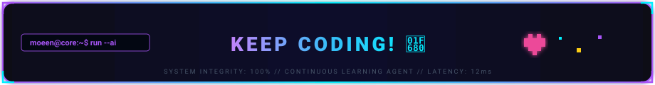
</div>
